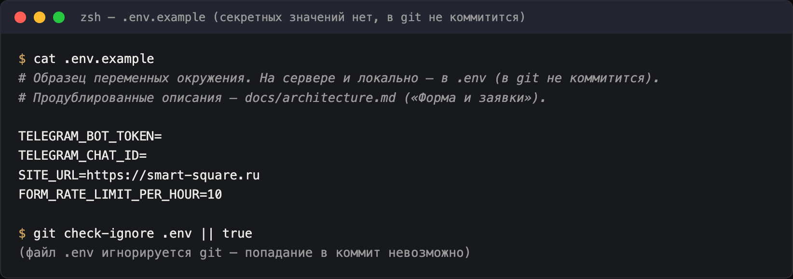
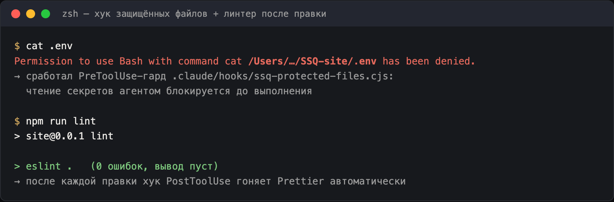
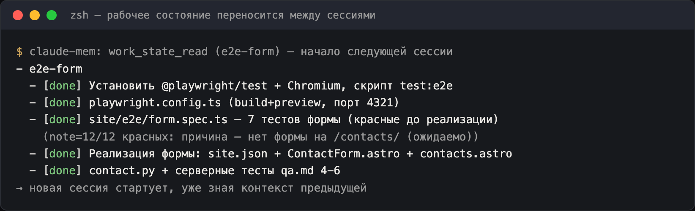
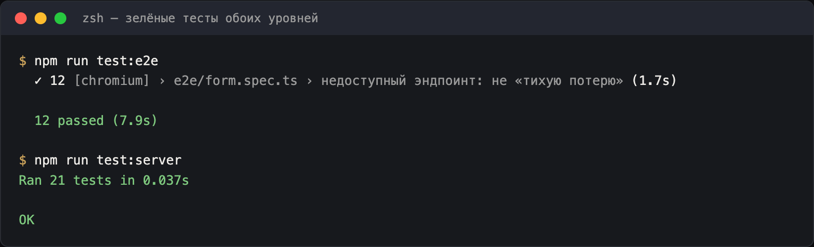

# Назначение файла

- Полное описание **AI-среды проекта**: стек инструментов агента, правила по путям, скиллы и доказательства того, что среда реально работает (скриншоты). README и `CLAUDE.md` держат только краткие указатели — подробности здесь, дублей нет.
- Позиционирование компании и факты для сайта перенесены в [content/strategy.md](content/strategy.md).

# Стек AI-среды

- **Claude Code** (CLI) — основной агент; рабочие правила в `CLAUDE.md`, разрешительная политика в `.claude/settings.json` (allow: гейты+коммит; ask: push; deny: `.env`, разрушающие операции).
- **Trail-code** — граф кода: `.trail/` (карта узлов + learnings в `.trail/learnings/`); поиск по коду — сначала `trail ask`/`trail grep`, не перебор файлов вручную. (До 2026-10-19 — graft, миграция: `.trail/learnings/2026-10-19-migrate-ssq-site-wiring-from-graft-evgenysozonov.md`.)
- **claude-mem** — перекрёстная сессийная память: `work_state_write/read` (канонический to-do), `mem_search` (поиск наблюдений), индекс сессии инжектится на старте.
- **superpowers** — процессные скиллы: планирование (brainstorm → план → test-first → ревью).
- **Playwright MCP** — браузер для e2e-испытаний и визуальной проверки (`webapp-testing`).

# Path-scoped rules: правило подгружается при обращении к зоне

Шесть правил в `.claude/rules/*.md` — зоны заданы через frontmatter `paths:` (glob).
При обращении агента к файлу внутри зоны текст правила инжектится в контекст инструмента
(system hook), если его ещё нет в контексте:

| Правило | Зона (`paths:`) | Что enforced |
|---|---|---|
| `astro-code.md` | `site/src/**` | каркас, острова по обоснованию, гейты lint/check/build |
| `typescript-strict.md` | `site/src/**/*.ts(x)` | strict: no `any`/ts-ignore, типы из zod |
| `style-tokens.md` | `site/src/styles/**` | design-значения только из tokens.css, reduced-motion |
| `form-cgi.md` | `site/public/cgi-bin/**`, `site/src/pages/contacts*` | контракт ssq-form-cgi, чек-лист qa.md после правок |
| `deploy-secrets.md` | `deploy.sh`, `.env*`, `site/public/**` | `.env` вне git, секреты вне docroot |
| `docs-truth.md` | `docs/**`, `CLAUDE.md` | синхронность докса и кода, лог решений в memory.md |

## Контрольный эксперимент path-scope (2026-10-18)

Дизайн: три зондирующих чтения — «внутри зоны», «вне всех зон», «в другой зоне» —
плюс контроль границы. Наблюдение велось по инжекциям в контекст инструмента
(PreToolUse-хук), сами пробы содержимого не меняли.

| Проба | Зона | Ожидание | Факт |
|---|---|---|---|
| `site/src/data/site.json` (повторно) | astro-code | повторная инжекция | нет: Read-дедуп вернул «файл не менялся», инжекции не было |
| `example/index.html` | вне всех зон | ничего | ✅ **ни одного** `.claude/rules` в инжекции |
| `site/src/styles/tokens.css` (повторно) | style-tokens | повторная инжекция | нет — правило уже в контексте сессии |
| `site/public/cgi-bin/contact.py` (впервые) | form-cgi + deploy-secrets | оба правила | нет — **оба правила уже в контексте** сессии |
| `site/package.json` | вне зон (`site/src/**`) | ничего | ✅ ничего не пришло |

**Вывод** (уровень достоверности: подтверждено в этой сессии; гипотеза о дедупликации помечена):

- ✅ **Вне зон правило не приходит никогда** — граница по glob работает, «утечек»
  правила в посторонние файлы нет (наблюдения чистые).
- ✅ **Инжекция реальна**: правила появлялись в контексте при первых касаниях зон
  (astro-code на `BaseLayout.astro`, style-tokens на `tokens.css`, form-cgi на
  `ContactForm.astro`, deploy-secrets на деплой-контексте) — это наблюдалось в ходе
  самой работы, до эксперимента.
- ⚠️ **Механика повторов — гипотеза**: после того как правило уже в контексте
  сессии, повторного ввода не происходит (и Read уже прочитанного файла тоже
  дедуплицируется). Это согласуется со всеми наблюдениями, но механика в свежей
  сессии отдельно не проверялась — проверить при первом запуске, который коснётся
  зоны впервые.

## Как проверили эксперимент (2026-10-18)

1. **PreToolUse-гард секретов** (`.claude/hooks/ssq-protected-files.cjs`): прямой запрос
   `cat .env` перехвачен до исполнения, агенту отказано (скриншот ниже). Это не
   «попросили не делать», а физический запрет на уровне инструмента.
2. **PostToolUse-автоформат**: после каждой правки файла хук гонит Prettier —
   дифы форматирования не остаются в рабочем дереве.
3. **docs-truth**: правки документации сработали вместе с правками кода в этом
   же шаге (перенос about → strategy, синхронные ссылки — см. git-историю).

# One-liner по скиллам (5 проектных + 1 официальный)

- `ssq-astro-conventions` — каркас: маршруты из `lines.json`, ноль JS вне островов, данные в `site/src/data/`.
- `ssq-typescript-strict` — strict TS: типы из zod-схем, запрет `any`/`ts-ignore`.
- `ssq-tailwind-tokens` — «Ночная медь»: палитра/шрифты/анимации через `tokens.css`.
- `ssq-form-cgi` — контракт формы: поля, honeypot, rate-limit, 400/502, секреты.
- `ssq-deploy-beget` — выкат/откат на Beget: гейты, rsync, smoke-тест из прода.
- (официальный) `webapp-testing` — Playwright-инструментарий браузера для проверок UI.

# Доказательства работы среды (рендеры реального вывода сессии 2026-10-18)

Примечание: на машине агента недоступен нативный `screencapture` (нет права
записи экрана у процесса), поэтому это рендеры **реальных выводов команд** этой
сессии в терминальном виде. Вывод команд — буквально из сессии; строки-подписи,
начинающиеся со стрелки «→», — пояснения, а не вывод терминала.

## Блок `.env` (пример) — секретов нет, в git не коммитится

## Хук защитил `.env` + линтер после правки

## Рабочее состояние переносят между сессиями (claude-mem)

## Зелёные тесты обоих уровней

# Смежные

- Краткие указатели — `README.md` (раздел «Как агент работает в проекте»).
- Ограничения агента — `CLAUDE.md` («Границы», «Анти-паттерны»).