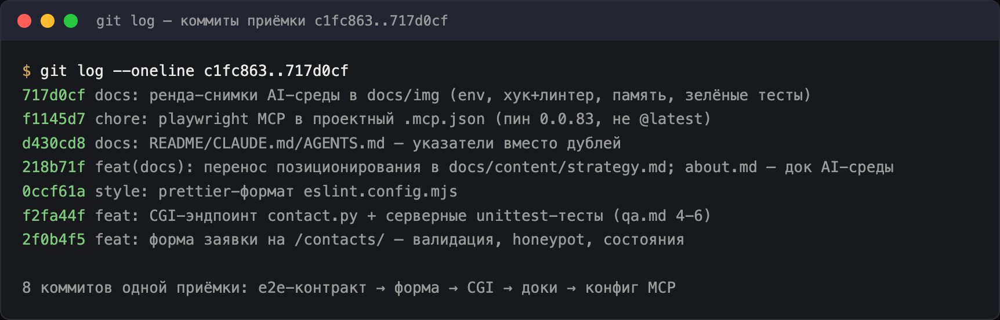
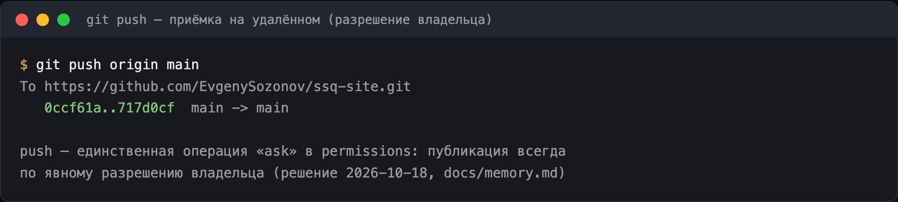
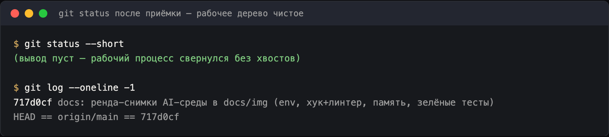

# Назначение файла

- Отчёт приёмки репозитория на конец дня 2026-10-18: что принято, состояние гейтов, открытые долги.
- Формат фиксируемых границ — хэши коммитов; состояние «сейчас» — [handoff.md](../handoff.md).

# Принято в репо сегодня (коммит-диапазон `c1fc863..717d0cf`)

| Что | Коммиты | Состояние |
|---|---|---|
| E2E-контракт формы заявки (Playwright, test-first) | `c1fc863` | 12 специ-тестов `/contacts/`, скрипт `test:e2e`, раннер собирает сайт сам (build+preview) |
| Форма заявки на `/contacts/` | `2f0b4f5` | `ContactForm.astro`: novalidate, свои ошибки (`aria-invalid`), honeypot `website`, состояния `idle→sending→ok/error`, фоллбек-телефон; `contacts.astro` + `site.json` |
| CGI-эндпоинт `contact.py` + серверные тесты | `f2fa44f` | stdlib, honeypot-маскировка, rate-limit `/tmp`, доставка Telegram, 400/502; `.htaccess` (ExecCGI); 21 unittest |
| Доки: перестройка о company-файлах | `218b71f` | позиционирование → `docs/content/strategy.md`; `about.md` → док AI-среды (стек, 6 path-scoped правил, эксперимент) |
| Указатели вместо дублей | `d430cd8` | README (раздел агента, актуальный «Запуск»), `CLAUDE.md` + «Стек», `site/AGENTS.md` — блок «Project rules for agents» |
| Playwright MCP в проект | `f1145d7` | `.mcp.json`, пин `@playwright/mcp@0.0.83` (не `@latest`); user-scope оставлен отдельно |
| Снимки доказательств AI-среды | `717d0cf` | `docs/img/ai-env-*.png` ×4 — рендеры реальных выводов сессии (screencapture недоступен, помечено в about.md) |
| Регресс хуков, формат | `81ab4f1`, `0ccf61a`, `226a064` | хуки `helpers/ → hooks/` + settings.json; prettier-формат eslint-config |

# Гейты на момент приёмки

- `npm run lint` — 0 ошибок (1 hint: старый deprecation `tseslint.config` в конфиге, не из работы дня)
- `npm run check` (astro check) — 0 ошибок
- `npm run build` — 2 страницы (index, contacts); оформленный `/404` в карте маршрутов ещё не создан
- `npm run test:e2e` — **12/12 passed** (~5–8 с; после красной фазы 12/12 до реализации формы)
- `npm run test:server` — **21/21 OK** (unittest, сеть не трогается; доставка подменена fake)
- 400px — горизонтального скролла нет (Chromium, живая проверка + скрин `tmp/ssq-contacts-400.png`)
- qa.md «Форма» — клиентские пункты 1–3: закрыты e2e; пункты 4–6 — серверные unittest
- Проверка эксперимента path-scope — зафиксирована в [about.md](../about.md) (отказ вне зоны чисто; гипотеза дедупа — отдельный пункт ниже)

# Открытые пункты (долги приёмки)

1. **Телефон-плейсхолдер**: `site/src/data/site.json` содержит `+7 (495) 000-00-00` — реальный номер не существует в доках; заменить в одном месте.
2. **`/legal/privacy/` не существует** — ссылка из чекбокса формы ведёт в 404; по 152-ФЗ страница нужна до выката формы (гейт 5 деплоя), реквизиты ИП — в [strategy.md](../content/strategy.md), ⏳.
3. **`deploy.sh` не создан** — пайплайн описан ([about.md](../about.md) скилл деплоя), скрипт не был согласован; в решёном виде: гейты → rsync `dist/` с `--backup` → откат.
4. **CGI в панели Beget** не включён/не проверен — до первого выката формы.
5. **Свежесессионная проверка дедупа path-scoped правил** — гипотеза из [about.md](../about.md): первая новая сессия, впервые касающаяся `site/src/**`, должна проинжектировать `astro-code.md`.
6. **Очистка `__pycache__` при выкате**: рантайм-артефакт уходит из `dist/` — исключить в rsync (defense-in-depth добавлен в план deploy.sh).
7. **Часы работы «Пн–Сб, 9:00–20:00»** в contacts.astro — придуманы как фоллбек, утвердить владельцем.

# Скриншоты приёмки в репозиторий

Рендеры реальных git-выводов сессии 2026-10-18 (нативный `screencapture` недоступен —
детали в [about.md](../about.md); пояснительные строки «→» — мои подписи, не вывод).

## Коммиты приёмки (граница c1fc863..717d0cf)

## Push на origin/main — публикация по явному разрешению владельца

## Чистое рабочее дерево после приёмки, HEAD == origin/main

# Факты для будущей приёмки

- Push идёт через `git -c credential.helper='!gh auth git-credential' push origin main` (одновременно глобальный helper не настроен — «Device not configured» у https).
- Форме посвящены три слоя проверки: клиент (e2e), сервер (unittest), прод (smoke-тест из скилла деплоя, пункт 7 гейтов).