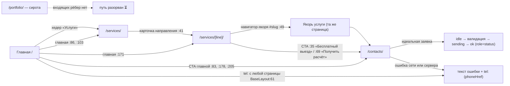

# UX-карта SSQ-site: путь заявки, экраны и переходы, состояния формы

**Назначение:** единая карта пути пользователя — экраны, рёбра переходов, состояния формы, разрывы пути.
**Скоп документа — флоу и состояния.** Каталог UI-паттернов не здесь: токены — `site/src/styles/tokens.css`, дизайн-система — `docs/DESIGN.md`.

**Канон — не здесь.** Документ описывает фактическое поведение кода и помечает планы ⏳. Канонические источники:

| Что | Канон |
|---|---|
| Маршруты, данные, деплой | `.planning/codebase/ARCHITECTURE.md` |
| Контракт формы (поля, honeypot, rate-limit, 400/502, доставка) | скилл `ssq-form-cgi` + `docs/specs/ssq-site-stack-design.md` §6.1 |
| Испытания формы | `site/e2e/form.spec.ts` (Playwright) |
| Гейты приёмки | `docs/qa.md` |
| Ревью юзабилити (шкала 0–4) | `docs/reports/`, скилл `ssq-usability-heuristics` |
| Лог решений по UX | `docs/memory.md` |

## Обслуживание документа (анти-устаревание)

Каждый раздел несёт проверочную команду. Обновлять раздел **до коммита** правки по триггеру:

| Триггер | Что обновить | Проверка |
|---|---|---|
| Добавлен/удалён маршрут | § Экраны | `find site/src/pages -name "*.astro" \| sort` |
| Правка хедера/футера/меню | § Рёбра переходов | `grep -n "href" site/src/layouts/BaseLayout.astro` |
| Правка формы или contact.py | § Состояния формы — здесь только ссылка на контракт, не переописывать | чек-лист «Форма» из `docs/qa.md` + `site/e2e/form.spec.ts` |
| Появились страницы `[service]` | § Экраны + § Разрывы (снять ⏳) | `ls "site/src/pages/services/[line]/"` |
| Встроили `/portfolio/` в навигацию | перенести из § Разрывы в § Путь заявки |
| Смена темы/токенов | сюда не заносить — только `docs/DESIGN.md` и `tokens.css` | `docs/DESIGN.md` |

## Путь заявки (золотой путь)

## Экраны

Проверка: `find site/src/pages -name "*.astro" | sort`

| Маршрут | Статус | Шаблон | Вход через |
|---|---|---|---|
| `/` | есть | `site/src/pages/index.astro` | хедер-лого (`BaseLayout.astro:43`), прямая |
| `/services/` | есть | `site/src/pages/services/index.astro` | хедер (`BaseLayout.astro:18`), главная (:86, :103), футер (:88) |
| `/services/[line]/` | есть | `site/src/pages/services/[line]/index.astro` | `/services/` (:41), главная (:171), хедер косвенно через `/services/` |
| `/services/[line]/[service]/` | ⏳ фаза 01 | план — `.planning/phases/01-dannye-i-karkas-uslug/01-PATTERNS.md` | ⏳ `[line]`-страница |
| `/contacts/` | есть | `site/src/pages/contacts.astro` | хедер (`BaseLayout.astro:19,67`), футер (:89), CTA главной и `[line]` |
| `/portfolio/` | есть, **осознанное исключение** | `site/src/pages/portfolio/index.astro` | входящих рёбер нет — решение владельца 2026-11-17: вне навигации, `noindex`, до реальных фото (запись в шапке файла) |
| `/legal/privacy/` | есть (2026-11-18), реквизиты ⏳ | `site/src/pages/legal/privacy.astro` | футер (`BaseLayout.astro:91`), чекбокс согласия формы (`ContactForm.astro:143`) |
| 404 | Astro default | — | любые неверные ссылки |

## Рёбра переходов (все `<a href>` сайта)

Проверка: `grep -rn "href" site/src/pages site/src/layouts`

| Откуда | Куда | Где |
|---|---|---|
| Хедер любой страницы | лого → `/`; «Услуги»; «Контакты»; телефон (tel: phoneHref) | `BaseLayout.astro:18-19,43,53,61` |
| Хедер CTA | `/contacts/` | `BaseLayout.astro:67` |
| Футер | `/services/`, `/contacts/`, `/legal/privacy/` | `BaseLayout.astro:88-91` |
| Главная | `/contacts/` (:83, :178, :205); `/services/` (:86, :103); `/services/[line]/` (:171); tel (:208) | `index.astro` |
| `/services/` | `/services/[line]/` — карточка направления | `services/index.astro:41` |
| `/services/[line]/` | якоря `#{service.slug}` внутри страницы (навигатор «Что вы ищете?») | `[line]/index.astro:49` |
| `/services/[line]/` | `/contacts/`: шапочный CTA :35 и CTA каждой услуги :69 | `[line]/index.astro` |
| `/contacts/` | tel (phoneHref) | `contacts.astro:29` |
| `/portfolio/` | нет исходящих ссылок | `portfolio/index.astro` |

Проверка сироты: `grep -rn "portfolio" site/src/pages/index.astro site/src/layouts/BaseLayout.astro` — ожидаемо пусто (осознанное исключение, см. § Разрывы).

## Состояния формы заявки (`ContactForm.astro`)

Контракт (поля, honeypot, rate-limit, доставка, 400/502) — скилл `ssq-form-cgi`; ниже только **состояния UI**. Проверка: `site/e2e/form.spec.ts` + чек-лист «Форма» `docs/qa.md`.

| Состояние | Триггер | Поведение | Код |
|---|---|---|---|
| idle | открытие / после reset | форма пуста, статус скрыт | `#contact-status hidden` (`ContactForm.astro:165`) |
| ошибка поля | submit с пустым именем/телефоном или неверным номером РФ | под полем текст ошибки, `aria-invalid`, фокус на первую ошибку; запрос не отправляется | валидаторы :207-219, setError :194-205, фокус :264 |
| повторная валидация | ввод в отмеченном ошибкой поле | подсветка снимается, как только поле стало валидным | revalidate :221-233 |
| ошибка согласия | чекбокс не отмечен | текст под согласием; снимается при чек-изменении | :260-263, :231-233 |
| sending | валидация пройдена | кнопка disabled, стрелка-карман → «…», статус скрыт | :267-270 |
| ok | `response.ok && data.ok` | `form.reset()`, снятие ошибок, подтверждение в `role=status` | :289-293 |
| серверная ошибка | response не ok / `data.error` | текст эндпоинта (например rate-limit) или общий текст + телефон как альтернативный канал | :294-301 |
| сетевой отказ | fetch бросил | тот же общий текст + телефон; «тихая потеря» исключена | :302-304 |
| возврат к idle | finally | кнопка разблокирована, стрелка пуста | :305-308 |

Длина комментария ограничена клиентским maxlength (см. файл, поиск `maxlength`); серверные лимиты — контрактом `ssq-form-cgi`.

## Разрывы пути пользователя (факты, решения — за владельцем)

Проверка раздела: `find site/src/pages -name "*.astro" | sort` + `grep -rn "href" site/src/layouts`

1. **Нет обратного ребра «назад к направлениям»** со страницы `[line]` на `/services/` — выход только через хедер и браузер назад. Эвристика навигации (скилл `ssq-usability-heuristics`, свобода и контроль): breadcrumb или «Все услуги направления» в подвале страницы.
2. **404-страница — Astro default**, без навигации к сервисам (нет ссылки на `/services/` с неё). Замечание: конвенция (`ssq-astro-conventions`) требует оформленную `/404` — расхождение каркаса с его же правилами, к фиксации в отдельной задаче.

**Осознанные исключения (решения владельца, не дефекты):**
- `/portfolio/` вне навигации и с `noindex` — решение 2026-11-17 (вплоть до реальных фото; в шапке `portfolio/index.astro`). При появлении фото: встроить по v1.1-плану из § «Планы».

## ⏳ Планы, меняющие карту

| План | Источник | Эффект на карту |
|---|---|---|
| Уровень `[service]`-страниц | фаза 01, `01-PATTERNS.md` | новый экран + ребро якорь→страница или `[line]`→`[service]` |
| Расширение списка услуг | `site/src/data/services/*.json` | новые якоря на `[line]`-страницах: карта не меняется |
| Портфолио/кейсы в пути заявки | ROADMAP v1.1 | ребро Главная/Услуги → Кейс → Контакты |

**Дата и фактура:** составлено 2026-11-18 по коду ветки `redesign/solstice`; все `file:line` — фактические позиции строк, сместились — проверять командами разделов, а не номерами строк.
